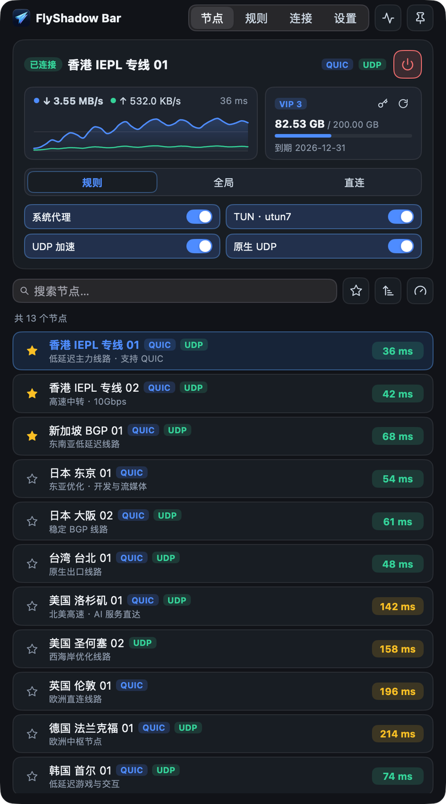
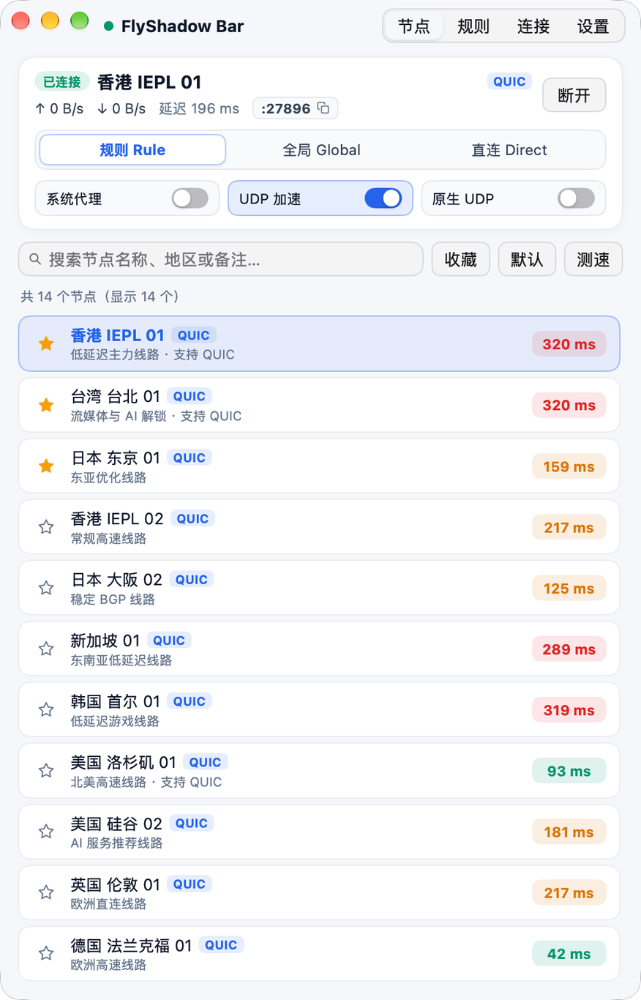
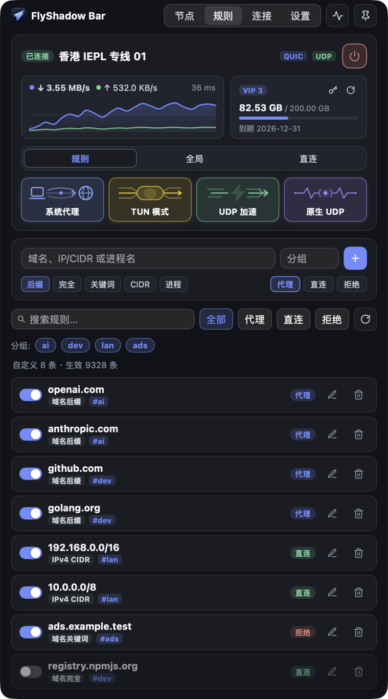
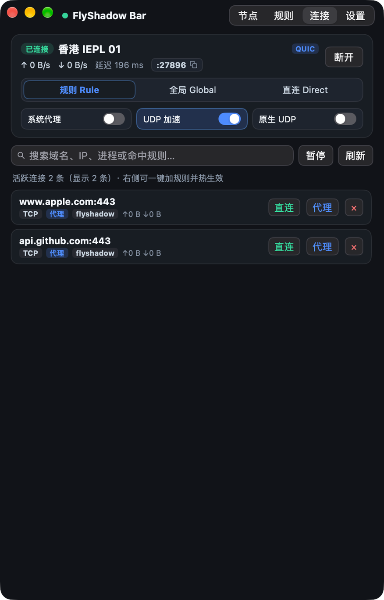

# FlyShadow Bar

基于 [`github.com/egoist/mygo`](https://github.com/egoist/mygo)（纯 Go、零 CGO、Native GPU UI）打造的轻量跨平台 FlyShadow 替代客户端与内置 CLI，直接调用官方底层 Rust 原生核心库，彻底告别官方 JVM / Compose 客户端的高内存占用与沉重体积。

## 界面预览

<table>
  <tr>
    <td align="center" width="50%">
      
      <br />
      <sub>深色模式 · 紧凑顶栏与高容量节点列表（单屏 11+ 节点）</sub>
    </td>
    <td align="center" width="50%">
      
      <br />
      <sub>浅色模式 · 跟随系统外观自适应</sub>
    </td>
  </tr>
  <tr>
    <td align="center" width="50%">
      
      <br />
      <sub>自定义规则管理 · 极速添加、分组启停与热生效</sub>
    </td>
    <td align="center" width="50%">
      
      <br />
      <sub>实时连接监控 · 一键加为直连/代理规则并刷新连接</sub>
    </td>
  </tr>
</table>

## 资源占用对比（vs 原版 FlyShadow）

原版桌面客户端基于 JVM + Compose Desktop + Skiko，仅后台常驻就会消耗数百 MB 物理内存。**FlyShadow Bar** 采用纯 Go 单进程架构与 `mygo` 原生 GPU 渲染（macOS Metal / Windows Direct3D 11），无 JVM、无 Electron、无 WebView 子进程，在 macOS（Apple Silicon）同机加载同一份订阅配置（9,300+ 分流规则与 CN GeoIP）实测对比如下：

| 对比维度 | 原版 FlyShadow（JVM / Compose） | FlyShadow Bar（纯 Go / MyGo） | 优化幅度 |
| --- | --- | --- | --- |
| **常驻物理内存（Footprint）** | ~619 MB | **~58 MB** | **直降 ~90%（节省 560+ MB）** |
| **应用安装体积（macOS `.app`）** | ~234 MB | **~14 MB** | **缩小 ~94%** |
| **分发压缩包体积** | ~90+ MB | **5.0 MB（macOS）/ 5.6 MB（Windows）** | **极致轻量** |
| **运行时依赖** | 内置整套 JRE + Skiko | **零运行时依赖（单二进制）** | **冷启动即开即用** |
| **连接监控后台开销** | 常驻刷新 | **仅打开「连接」页按需轮询** | **常驻空闲 0% CPU** |

> 注：内存数据取自 macOS 实机 `top` 的进程物理内存（`MEM`），实际数值会随系统版本与连接数略有波动。

## 核心特性

- **单进程直连原生核心库**：macOS 通过 `purego`、Windows 通过 `x/sys/windows` 以零 CGO 方式加载官方底层动态库（`libflyshadow_core_lib.dylib` / `flyshadow_core_lib.dll`），自动加载 GeoIP 与分流规则。
- **菜单栏与系统托盘极速控制**：常驻 macOS 菜单栏（默认隐藏 Dock 图标，可选等宽字体实时速率显示）与 Windows 系统托盘；支持模式切换、节点子菜单（收藏置顶、彩色延迟徽章、macOS 原地热切换）、系统代理、UDP 加速（QUIC）、原生 UDP、一键测速与安全退出。
- **紧凑高容量原生 UI**：浅色 / 深色 / 跟随系统外观自适应；单屏直接展示 11+ 节点，支持搜索、收藏、按延迟排序、并发测速与一键复制终端代理环境变量。
- **自定义规则热管理**：完整兼容官方 `~/.FlyShadow/config.json` 中的 `customRuleList`、`customRuleActiveLabels` 与全部 13 种官方匹配类型，支持极速添加、行内编辑、启停、删除与标签分组切换，修改后**无需断开隧道立即热生效**。
- **实时连接监控与一键加规则闭环**：对接核心库 `get_tunnel_mapper_info_json` 与 `close_connect`，查看实时活跃连接的目标域名、进程名、路由结果与流量，可一键将任意目标加入直连/代理规则并踢掉旧连接使新规则即刻生效。
- **单二进制内置 CLI**：无参数运行即启动常驻 GUI；携带子命令时自动发现并通过本机回环 Bearer Token 控制接口操控正在运行的实例，支持终端与 SSH 远程运维，全部命令支持 `--json` 输出。
- **跨平台系统代理与安全退出**：支持 macOS / Windows 系统代理一键开关、启动连上后自动开启（同步 `autoSetSysProxyOnStartUp`），退出时自动关闭系统代理并安全断开隧道。
- **无损配置写回**：按 `map[string]json.RawMessage` 原子写回 `config.json`，完整保留账号 token、订阅密码等所有原生字段；本客户端自身外观偏好独立保存在 `flyshadow-bar.prefs.json`。
- **GitHub Releases 自动更新**：内置版本检测与更新引导，支持应用内检查与 CLI 一键下载最新安装包。

## 自动查找规则

启动时会自动定位配置文件、原生核心库与 GeoIP 数据库，所有路径均支持环境变量覆盖。

### 配置文件

按以下优先级查找：

1. 环境变量 `FLYSHADOW_CONFIG_PATH` 指定的完整路径。
2. 环境变量 `FLYSHADOW_CONFIG_DIR` 下的 `config.json`。
3. 默认配置目录：
   - **macOS**：`~/.FlyShadow/config.json`
   - **Windows**：`%USERPROFILE%\.FlyShadow\config.json`

客户端自身的轻量界面偏好保存在同一目录下的 `flyshadow-bar.prefs.json`，运行时本地控制发现文件保存在 `flyshadow-bar.run.json`（权限 `0600`，退出自动清理）。

### 原生核心库

按以下优先级查找（显式设置 `FLYSHADOW_CORE_LIB` 环境变量时优先使用）：

- **macOS**（`libflyshadow_core_lib.dylib`）：
  1. 可执行文件同级目录、`.app/Contents/Resources`、`.app/Contents/Frameworks` 及当前工作目录。
  2. `~/.FlyShadow/lib/<最新版本>/libflyshadow_core_lib.dylib`（按语义化版本号降序选取）。
  3. 自动扫描 `/Applications/FlyShadow.app/Contents/app/common-desktop-*.jar`（及 `~/Applications/` 下对应路径），解压 `darwin-aarch64/libflyshadow_core_lib.dylib` 并缓存至 `~/.FlyShadow/flyshadow-bar-cache/`。
- **Windows**（`flyshadow_core_lib.dll`）：
  1. 可执行文件同级目录及当前工作目录。
  2. `%USERPROFILE%\.FlyShadow\lib\<最新版本>\flyshadow_core_lib.dll`。
  3. 常见安装目录（`%LOCALAPPDATA%`、`%ProgramFiles%`、`%ProgramFiles(x86)%` 下的 `FlyShadow` 与 `Programs\FlyShadow`，及其 `app`、`lib`、`resources` 子目录）。
  4. 自动扫描上述安装目录内的 `common-desktop-*.jar`，解压 `win32-x86-64/flyshadow_core_lib.dll` 并缓存至 `%USERPROFILE%\.FlyShadow\flyshadow-bar-cache\`。

### GeoIP 数据库

按以下优先级查找 `Country-only-cn-private.mmdb`：

1. 环境变量 `FLYSHADOW_GEOIP` 指定的路径。
2. 可执行文件候选目录、`~/.FlyShadow`、`~/.FlyShadow/geoip`、`~/.FlyShadow/flyshadow-bar-cache`。
3. 自动从官方 `common-desktop-*.jar` 中的 `geoip/Country-only-cn-private.mmdb` 解压并缓存。

### 环境变量一览

| 环境变量 | 说明 |
| --- | --- |
| `FLYSHADOW_CONFIG_DIR` | 自定义 FlyShadow 配置目录（默认 `~/.FlyShadow`） |
| `FLYSHADOW_CONFIG_PATH` | 自定义 `config.json` 完整路径 |
| `FLYSHADOW_CORE_LIB` | 显式指定原生动态库路径（`.dylib` / `.dll`） |
| `FLYSHADOW_GEOIP` | 显式指定 `Country-only-cn-private.mmdb` 路径 |
| `FLYSHADOW_BAR_RUN_FILE` | 自定义运行态发现文件路径（默认 `~/.FlyShadow/flyshadow-bar.run.json`） |

## CLI 使用说明

无参数运行 `flyshadow-bar` 将启动菜单栏 / 托盘 GUI（支持 `--hidden` 静默驻留托盘）。应用运行期间，可在终端直接调用以下子命令进行控制（均可附加 `--json` 输出结构化数据）：

| 子命令 | 别名 | 说明 |
| --- | --- | --- |
| `status` | - | 查看当前连接状态、节点、代理模式、端口、传输协议与实时速率 |
| `ls` | `nodes` | 列出所有可用订阅节点、收藏状态、QUIC/UDP 标签与延迟 |
| `node <query>` | `use <query>` | 按节点 ID、精确名称或关键词热切换当前节点 |
| `mode <mode>` | - | 切换代理模式，支持 `rule`（规则）、`global`（全局）、`direct`（直连） |
| `udp <on\|off\|toggle>` | - | 开启、关闭或切换 UDP 加速（QUIC）并热重连 |
| `native-udp <on\|off\|toggle>` | - | 开启、关闭或切换原生 UDP 转发并热重连 |
| `sysproxy <on\|off\|toggle>` | - | 开启、关闭或切换操作系统代理 |
| `ping` | - | 触发全量节点并发延迟测速并按延迟排序输出 |
| `reload` | - | 重新加载 `config.json` 与域名分流规则并刷新引擎状态 |
| `rules` | `rule ls` | 列出所有自定义分流规则（ID、状态、匹配类型、规则值、动作、标签） |
| `rule add <value>` | - | 快速添加自定义规则并立即热生效（支持 `--match`、`--action`、`--label`） |
| `rule toggle <id>` | - | 启用或禁用指定自定义规则并热生效 |
| `rule rm <id>` | `rule del` | 删除指定自定义规则并热生效 |
| `conns` | `connections` | 查看底层核心库当前的实时活跃连接列表 |
| `version` | - | 输出客户端版本号、提交哈希与构建时间 |
| `update` | - | 检查 GitHub Releases 最新版本（`--download` 自动下载安装包） |

### 常用示例

```bash
# 查看运行状态与全部节点
flyshadow-bar status
flyshadow-bar ls

# 按关键词或节点 ID 热切换节点
flyshadow-bar use 香港
flyshadow-bar node 12

# 切换代理模式与 UDP / 系统代理开关
flyshadow-bar mode rule
flyshadow-bar udp on
flyshadow-bar native-udp toggle
flyshadow-bar sysproxy on

# 全量测速与热重载配置
flyshadow-bar ping
flyshadow-bar reload

# 自定义规则快捷管理（立即热生效，不中断隧道）
flyshadow-bar rules
flyshadow-bar rule add openai.com --match suffix --action proxy --label ai
flyshadow-bar rule add 192.168.0.0/16 --match cidr4 --action direct
flyshadow-bar rule toggle 1
flyshadow-bar rule rm 1

# 查看实时活跃连接
flyshadow-bar conns

# 查看版本与检查更新
flyshadow-bar version
flyshadow-bar update --download
```

## 本地开发与测试

项目全程使用 `CGO_ENABLED=0` 构建，无需安装 C 编译器。

```bash
# 直接运行
make run

# 编译本机可执行文件到 bin/flyshadow-bar
make build

# 运行全量单元测试
make test

# 运行核心库实机冒烟测试（使用临时高端口，不干扰宿主机代理）
make test-live

# 清理编译与打包产物
make clean
```

## 打包与交叉编译

生产构建会自动注入版本元信息、剥离符号表（`-s -w`），并启用 `mygo` 生产标志（`-X github.com/egoist/mygo.production=1`）与 `-tags mygo_noinspector`。

```bash
# 在 macOS 上打包 dist/FlyShadow Bar.app 与 dist/flyshadow-bar-<version>-darwin-arm64.zip
make app

# 零 CGO 交叉编译 Windows amd64（可在 macOS / Linux 上直接执行）
# 输出 dist/flyshadow-bar.exe 与 dist/flyshadow-bar-<version>-windows-amd64.zip
make win

# 本地一键构建双平台产物并生成 dist/checksums.txt
make release-local
```

## 自动发布流程

仓库通过 [`.github/workflows/release.yml`](.github/workflows/release.yml) 实现严谨的自动化发版：

1. 推送语义化版本标签（例如 `v0.1.0`）：
   ```bash
   git tag v0.1.0
   git push origin v0.1.0
   ```
2. GitHub Actions 将自动依次完成：
   - **准备草稿（prepare）**：校验标签规范与 `origin/main` 祖先关系，防止覆盖已公开版本，并调用 DeepSeek API（需在仓库 Secrets 中配置 `DEEPSEEK_API_KEY`）基于提交记录自动生成面向用户的简体中文更新说明，创建 Draft Release。
   - **测试与双平台并行构建（check / build-macos / build-windows）**：运行单元测试与 macOS/Windows 双平台 `go vet`，在 `macos-latest` 构建 `darwin/arm64` `.app`/`.zip`，在 `ubuntu-latest` 零 CGO 交叉编译 `windows/amd64` `.exe`/`.zip` 并上传至草稿。
   - **校验与公开发布（publish）**：验证全部产物齐全，生成 `checksums.txt` 上传并将草稿转为正式最新 Release；若中间任一环节失败或取消，**cleanup** 会自动删除未公开草稿。
